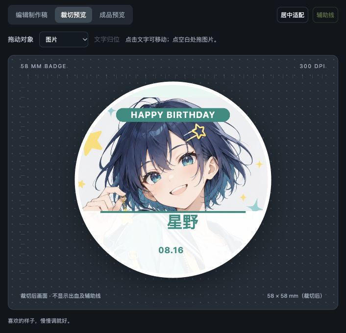

# 谷子工坊 · Guzi Workshop

把喜欢，做成谷子。

一个面向二次元周边制作的浏览器排版工具：从一张角色图开始，制作吧唧、拍立得和圆角贴纸，再导出含出血的制作稿与拼版文件。无需注册，图片在本地处理，不上传到服务器。

Local-first anime merch layout editor for badges, photo cards and stickers. Built with vanilla JavaScript and Canvas; no backend or runtime dependencies.



## 能做什么

- **一张图，三款谷子**：生成吧唧、拍立得和贴纸整套，每款的尺寸、构图、文字与风格可独立调整。
- **风格模板**：自由排版、生日应援、简洁角色名、复古拍立得；可修改名字、纪念日和应援配色。
- **直观编辑**：拖动图片和文字，缩放、旋转、方向键微调，支持撤销与文字归位。
- **制作辅助**：毫米尺寸、出血边界、裁切线、安全区域；检查有效图片 DPI 和文字位置。
- **真实裁切预览**：隐藏出血，保留制作稿的原构图，不重新适配图片；另提供成品效果示意图。
- **批量与拼版**：最多 20 张素材，每张最多 20 MB、4000 万像素；A4 / 自定义纸张，多页 PDF 自动排版，PNG / ZIP 导出。
- **项目备份**：IndexedDB 自动保存到当前浏览器，支持包含图片和参数的 `.guzi` 文件导入、导出。

## 快速开始

安装 Node.js 18 或以上版本，然后：

```sh
git clone https://github.com/Nafixcn/guzi-workshop.git
cd guzi-workshop
npm start
```

打开 [http://127.0.0.1:5173](http://127.0.0.1:5173)。应用没有运行时依赖，**不需要先执行 `npm install`**。

也可以使用其他静态服务器托管 `dist/`。请通过 HTTP / HTTPS 打开，不要直接双击 HTML 文件；项目使用 ES modules 和浏览器存储。

## 从图片到制作稿

1. 上传 PNG、JPG 或 WebP 图片，或载入内置原创示例。
2. 选择谷子类型、尺寸和风格，按制作方要求设置出血与安全边距。
3. 拖动图片调整构图，填写角色名、日期或文案。可点击文字直接移动。
4. 需要三件套时，点击「生成一整套」，逐款检查并微调。
5. 切换「裁切预览」，检查成品边缘和文字位置，处理制作前检查中的提示。
6. 导出 PNG、拼版 PDF 或整套 ZIP，并用「保存项目」下载 `.guzi` 备份。

### 操作提示

| 操作 | 效果 |
| --- | --- |
| 拖动画布中的图片 / 文字 | 调整对应对象位置 |
| 「拖动对象」下拉框 | 明确选择图片、角色名、日期或文案 |
| 方向键（画布获得焦点时） | 微调当前对象 |
| Shift + 方向键 | 更大步长移动 |
| Esc | 返回图片编辑 |
| 滚轮（选择图片时） | 缩放图片 |
| 「文字归位」/「撤销」 | 归位当前文字 / 撤销最近编辑 |

## 导出文件有什么区别

| 文件 | 内容与用途 |
| --- | --- |
| 当前制作稿 PNG | 含出血、无编辑辅助线，写入 PNG pHYs 分辨率信息 |
| 拼版 PDF | 按实际毫米设置纸张尺寸，包含裁切参考标记，支持多页 |
| 全部素材 ZIP | 批量 PNG 制作稿与制作参数；共享版式，各自保留图片变换 |
| 整套 ZIP | 三张 PNG、三份各款拼版 PDF、整套示意图和制作参数 |
| 成品预览 PNG | 效果示意，不是印刷制作稿 |
| `.guzi` 项目 | 图片和编辑参数，用于继续编辑和迁移设备，不是交付印刷文件 |

PNG 像素尺寸为 `（成品毫米尺寸 + 两侧出血）× DPI ÷ 25.4`，取整到像素。例如 58 mm 吧唧、每侧 3 mm 出血、300 DPI，导出约为 **756 × 756 px**。

PDF 为高质量 JPEG 栅格页面，不是可编辑矢量文件。打印请选择 **实际大小 / 100%**，不要选择适应纸张。

## 印刷前请确认

- 默认尺寸和出血仅用于试排版，**不代表所有厂商的制作规范**；请以实际制作方模板为准。
- 当前使用 RGB，不提供 CMYK / ICC 转换、白墨专色、异形刀模或 PSD / AI 编辑。
- DPI 检查不能代替肉眼判断；放大查看图片与文字，人脸和主体裁切需要手动确认。
- 成品预览不模拟真实材质、曲面、工艺或最终印刷颜色。
- 上传素材请确认使用权限；本项目不提供第三方角色图库或素材抓取功能。

## 导入制作方规格

把制作方提供的几何规格保存为 JSON，通过「导入模板」加载：

```json
{
  "format": "guzi-template",
  "version": 1,
  "type": "badge",
  "width": 58,
  "height": 58,
  "bleed": 3,
  "safe": 3
}
```

`type` 支持 `badge`、`photo`、`sticker`；尺寸单位为毫米，圆形吧唧的宽高必须一致。此功能仅导入规格，不解析 PSD / AI 文件。

## 本地数据与隐私

图片处理、排版和文件生成均在浏览器中完成。应用没有账户系统、云端项目同步或图片上传接口，字体使用本机系统字体，不请求外部字体。

自动保存仅属于**当前浏览器、当前站点地址**；换设备、换地址、使用无痕模式或清理浏览器数据，都可能无法找回原项目。请定期下载 `.guzi` 文件备份。项目文件包含原图片，分享前请检查内容。

支持 `.guzi` v2 整套项目，并兼容 v1 单款项目。`dist/sample.png` 为本项目生成的原创示例角色图，不包含第三方角色素材。

## 开发与检查

```sh
npm run check
npm test
```

基础测试使用 Node.js 内置测试运行器，无需安装依赖；覆盖参数校验、文字移动、整套独立性、毫米与像素换算、拼版、PNG 分辨率、ZIP 校验和 PDF 结构。

如需验证真实 PNG、ZIP 和 PDF 输出，可选择安装测试库后运行：

```sh
npm install --no-save --package-lock=false @napi-rs/canvas sharp jszip pdf-lib
node tests/verify-exports.mjs
```

这些库仅用于可选验证，不属于应用运行依赖。脚本把验证输出写入系统临时目录，并打印所在路径。也支持通过 `GUZI_NODE_MODULES` 指向已安装的测试库目录。

### 项目结构

```text
dist/
  index.html          页面与控件
  style.css           桌面与移动端布局
  app.js              交互、项目存储与导出流程
  engine.js           尺寸、渲染、检查、PNG / PDF / ZIP 核心
  sample.png          原创示例图片
server.mjs            本地静态服务器
tests/                单元测试与导出验证
.openai/hosting.json  原 Sites 托管配置，本地运行不依赖它
tools/                原 Sites 发布辅助脚本，普通使用无需运行
```

`dist/` 是可直接托管的源文件目录，不需要构建。部署到其他静态托管平台时，只需使用 `dist/`，不必配置原 Sites 项目 ID。

## 反馈与版本

欢迎通过 [Issues](https://github.com/Nafixcn/guzi-workshop/issues) 报告问题或提出想法。建议附上浏览器、复现步骤和截图；请勿上传含私人图片的项目文件。

版本变化见 [CHANGELOG.md](CHANGELOG.md)。代码采用 [MIT 许可证](LICENSE)；用户自行导入的素材仍由其各自权利人享有权利。
